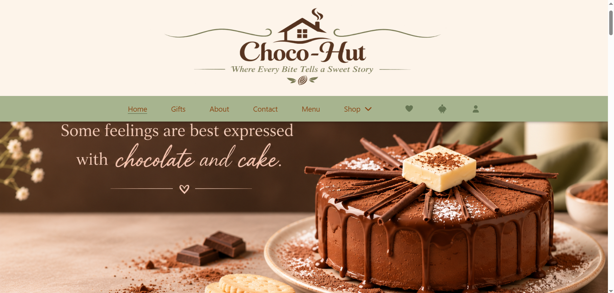
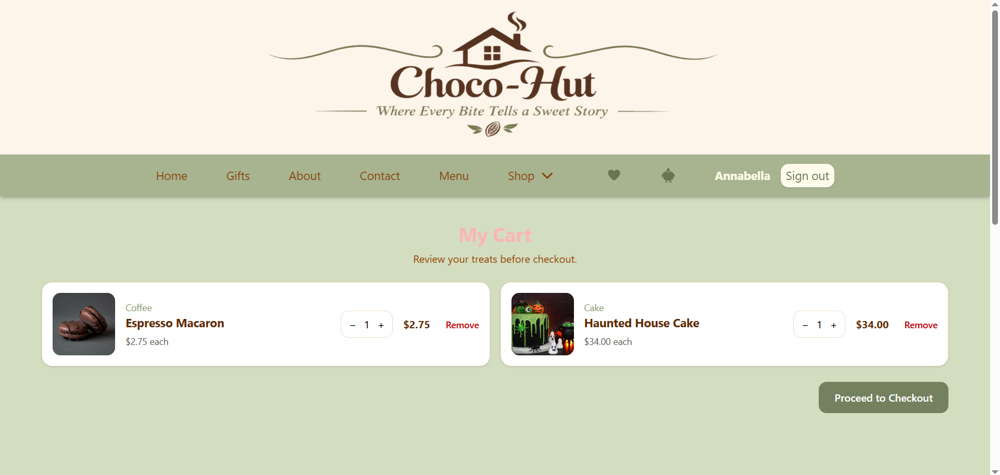
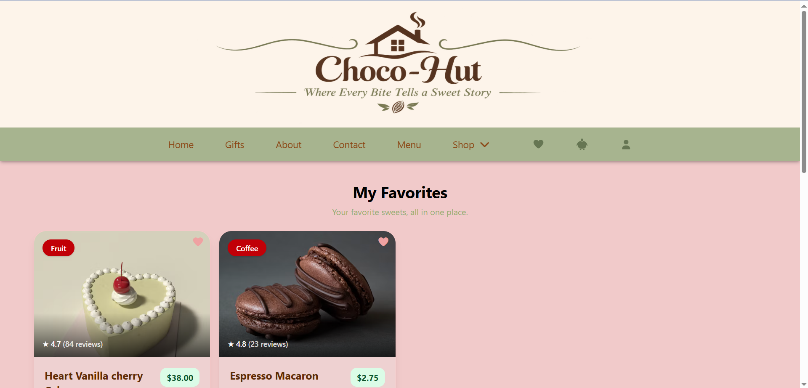
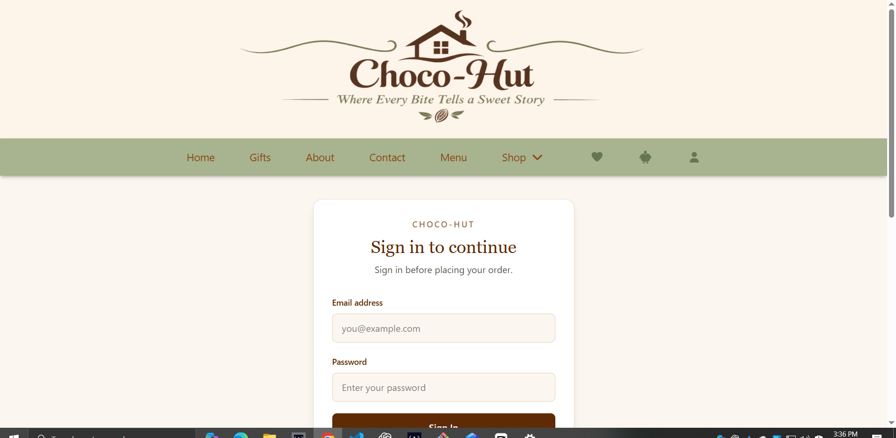
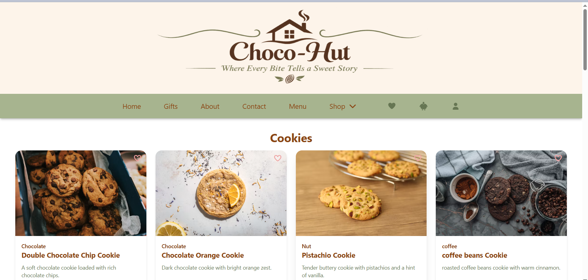
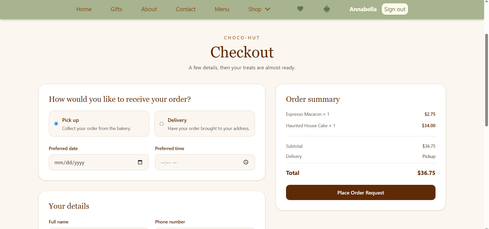
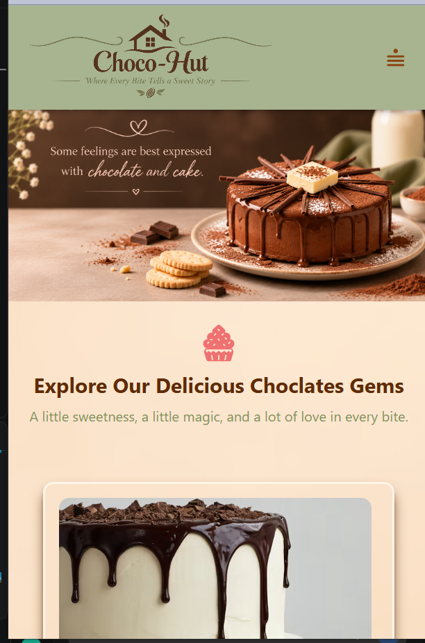

# 🎂 Choco-Hut

Choco-Hut is a responsive bakery storefront for discovering handcrafted cakes, cupcakes, cookies, macarons, pastries, and desserts. Visitors can browse product categories, view item details, save favorites, and add treats to a cart. The site also includes a gift collection and a contact page, with a warm visual style inspired by the bakery’s cream, chocolate, and sage-green palette.

--------------------------------------------------

## ✨ Features

- Responsive navigation with category dropdowns on desktop and mobile
- Product cards with photos, descriptions, ratings, and prices
- Product detail pop-ups with ingredients, allergens, and stock status
- Save-to-favorites and shopping cart features
- Front-end sign-in and sign-out interface that displays the user’s name
- Dedicated product pages for bakery categories and seasonal collections
- Gift collection with a video section
- Contact form with a front-end confirmation message
- Add menu with their price
- Separate seasonal and holiday specials section
-----------------------------------------------

## 🛠️ Tech stack

- Vite
- React 19  ..... Component-based UI development 
- JavaScript (ES6+) ...  Application logic and  interactivity 
- Tailwind CSS 4  .... Styling and responsive layouts 
- React Router  .... Client-side navigation 
- Context API  ... Shared application state 
- localStorage  ...  Browser-side data persistence 
- Vite  Development server and build tooling 
- Git & GitHub  ... Version control and project hosting
-  
------------------------------------------------

## 🧠 Key Concepts Practiced

KUPONG demonstrates practical application of core frontend development concepts, including:

- Component-based architecture and reusable UI
- React Hooks, including `useState` and `useEffect`
- `useContext` for shared data
- React Router for page navigation
- Event handling and interactive UI elements
- JavaScript array methods for working with product data
- Browser storage with `localStorage`
- Responsive layouts using Tailwind CSS
- Organizing code into components, pages, and supporting modules
- Managing dependencies and running a Vite development environment

------------------------------------------------------------

## Demo notes

Sign-in is a front-end demonstration using browser local storage; it does not verify accounts with a server. The contact form displays a confirmation message but does not send email. A live store would need a backend or suitable service for account authentication, orders, and contact messages.

------------------------------------------------------

## 📸 Screenshots

Suggested screenshots:
- Home page
- Product page
- Product details
- Shopping cart
- Saved products
- Login or registration page
- Checkout page
- Mobile screen (Responsiveness chk)

















-----------------------------------------------------------------------

## live-demo 🌐

[choco-Hut live-demo](https://amnaakhtar1213.github.io/choco-hut/)

----------------------------------------------

## Clone the Repository
```bash
git clone https://github.com/Amnaakhtar1213/choco-hut.git


------------------------------------------------------


⭐ If you find this project interesting, feel free to explore the repository and follow my frontend development journey!